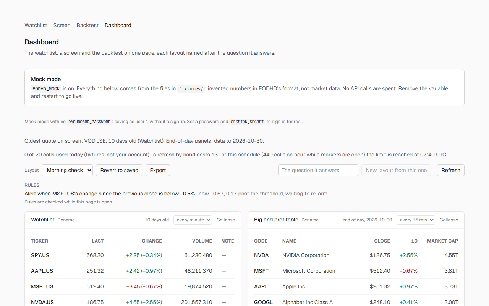

# Market cockpit

A personal market dashboard on the [EODHD APIs](https://eodhd.com/financial-apis/): a watchlist, a stock screen, a backtest and threshold checks on one page, for one person who wants to know how old every number is and what each refresh costs. Built on the course starter, for me in four months and anyone who finds it on my profile.



## Run it

1. `git clone https://github.com/EodHistoricalData/academy-dashboard-starter && cd academy-dashboard-starter`
2. `npm ci`
3. `cp .env.example .env.local`   (then set `EODHD_API_KEY`, or `EODHD_MOCK=1` to run on fixtures)
4. `npm run dev`
5. Open http://localhost:3000/dashboard

## What you need first

- **Node 22.13 or later.** `.nvmrc` names 22, so `nvm use` picks it. The document store uses Node's built-in `node:sqlite`, which needs no flag from 22.13.
- **A free EODHD API key**, from [eodhd.com/register](https://eodhd.com/register). It goes in `.env.local` as `EODHD_API_KEY`, never in a variable starting `NEXT_PUBLIC_`. The free plan is 20 API calls a day.
- **npm 11 or later may warn** that `unrs-resolver` has an install script not covered by `allowScripts`. Nothing needs it: lint and the app run without it.
- **Or no key at all: mock mode.** With `EODHD_MOCK=1` every request is answered from the JSON files in `fixtures/`, nothing goes over the network and nothing is spent. Every page says so at the top, because invented numbers that look live are worse than none. `fixtures/README.md` says how to add one.
- **To keep layouts, notes and rules on the server:** `DASHBOARD_PASSWORD` (what you sign in with at `/login`) and `SESSION_SECRET` (a long random string: `node -e "console.log(require('crypto').randomBytes(32).toString('base64url'))"`). In mock mode with no password, user 1 is assumed and the pages say so. `.env.example` lists every variable and its default.

## What it does

- **Watchlist** (`/`): your tickers (`src/lib/watchlist.ts`) in one request, with each quote's age read from its own timestamp, notes per ticker, and threshold rules.
- **Screen** (`/screen`): the biggest profitable US companies by market capitalisation, filters you can change, saved screens and a shortlist that needs a reason.
- **Backtest** (`/backtest`): a moving-average crossover on daily bars against buy and hold, with costs, fills at the next open, a walk-forward split and a report.
- **Dashboard** (`/dashboard`): the three as panels on one page, named layouts, a selection that follows across panels, and each panel in one of five states: loading, refreshing, ready, empty or failed.
- **Says what it costs.** What a refresh by hand costs, calls used today, and when the day's allowance runs out at the current schedule. Each panel refreshes every minute, every 15 minutes, once a day or by hand.

## What it does not do

- **It is not real-time.** A quote is as old as its last trade; TODO: the measured gap between changes for one liquid and one thin symbol (`PLAN.md`, Update intervals).
- **It does not refresh much on the free plan.** The default layout costs 13 calls a refresh; 20 a day buys one. After that it keeps the morning's numbers on screen, labelled stale, until 00:00 UTC.
- **It does not send alerts.** Rules are checked only while the dashboard is open; a server checking one rule every 5 minutes would need 78 calls a day.
- **It does not screen outside the US.** One exchange, 18,012 common stocks of 51,215 US instruments, 20 rows a screen, 5 calls a screen.
- **It does not test across regimes.** The free plan reaches one year of daily bars (251 in the fixture); no 2008, 2020 or 2022.
- **It does not know market holidays.** On one, the refresh loop asks anyway and the ages show nothing moved.
- **It has one owner.** One password, one user in the store; it is not built for several people.
- **It does not advise or trade.** Nothing it shows is investment advice.

## How it works

**The browser never calls the API.** Every market request from the browser goes to `/api/proxy/...`, a route on this server that adds the key and forwards only the endpoints on its list (`src/lib/proxy.ts`). The key is read in one file, `src/lib/eodhd.ts`, on the server. A free key in a public bundle is scraped within days; this is why there is no other way in.

**Panels do not fetch.** Each panel declares what it needs; the dashboard (`src/components/Cockpit.tsx`) unions the needs of the open panels, asks once per symbol through one market store (`src/lib/market-store.ts`), and hands each panel its rows. Two panels showing the same symbol cost one call.

**Every number carries its age.** Rows in one response can be a minute or more apart, so there is no single "as of": each panel shows its own age, and the header names the oldest. The age is from the data's timestamp, not from the plan's name for it.

**Prices are worked out before anything is sent.** `src/lib/cost.ts` holds what each endpoint costs in calls (`real-time` is one call per ticker, `fundamentals` ten) and `estimateCalls()`; the refresh budget (`src/lib/budget.ts`) prices a refresh from the same requests the fetchers send, so the figure on screen cannot drift from the fetch. `/api/usage` reads today's count from the free user endpoint.

**Documents live in one SQLite file.** Saved screens, the shortlist, notes, layouts and rules are documents in `.data/app.db` (gitignored), one row per user and key, each write checked against the version it read, so a second tab cannot silently overwrite the first.

**It checks itself.**

```bash
npm test             # no key, no network
npm run typecheck
npm run lint
npm run check:leak   # builds with a made-up key and fails if its value lands in the output
```

`npm install` turns on the git hooks in `.githooks/`: pre-commit refuses anything shaped like a key and lints the staged files; pre-push runs the tests, the type check and the leak check. CI (`.github/workflows/key-scan.yml`) runs the same on every pull request, plus a scan of the whole history. If a key ever reaches a public repository, rotate it: removing the commit is not enough.

**It was built with an agent.** `AGENTS.md` holds the rules the agent reads every session, `.claude/settings.json` keeps it out of `.env*` files, and `.mcp.json` connects the [EODHD MCP server](https://eodhd.com/financial-apis/mcp-server), which signs in with OAuth: there is no key in it. MCP questions spend the same daily calls as the app. The prompts the course uses are in [`prompts/`](prompts/), and `PLAN.md`, `REVIEW.md` and `REFERENCE.md` say what was decided and why.

## Licence

The code is MIT: see [LICENSE](LICENSE). The market data it fetches is not covered by that licence and is not yours to redistribute: see [NOTICE](NOTICE).
